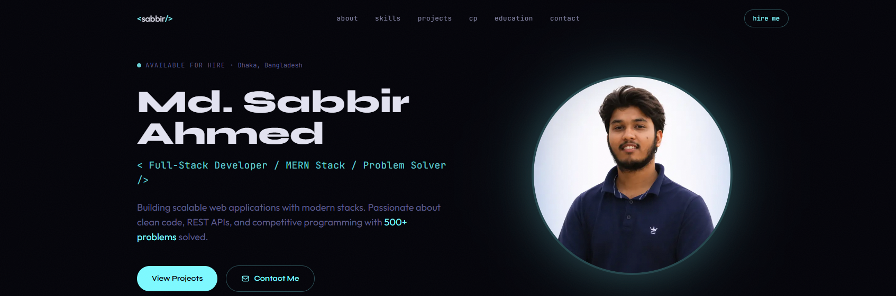

  

 

  
  
  

---

## 👨‍💻 About Me

I'm a **Full-Stack Web Developer**  I build scalable, production-ready web applications and enjoy turning real-world problems into clean, maintainable software.

- 🔭 Building with the **MERN stack**, **Next.js**, **TypeScript** and **Supabase**
- 🌱 Currently learning **LangChain**, **LangGraph** and **Docker**
- 👨‍🏫 Teaching web development and programming
- 🧩 **500+ problems solved** across Codeforces, LeetCode and CodeChef
- 💼 Open to freelance work and remote / international opportunities

---

## 🧰 Tech Stack

**Languages:**
 

**Frontend & State Management:**
 

 

**Backend:**
 

**Database & ORM:**
 

 

**AI & LLM Engineering:**
 

**Tools & Deployment:**
 

---

## 🚀 Featured Projects

<table>
  <tr>
    <td width="33%" valign="top">
      <h3>🐙 DevHub / MyGit</h3>
      A GitHub clone with a custom Node.js CLI version control tool.
        
      
      
      
    </td>
    <td width="33%" valign="top">
      <h3>📦 ParcelPro</h3>
      Parcel delivery platform with admin and rider workflows, Stripe payments and analytics dashboards.
        
      
      
      
    </td>
    <td width="33%" valign="top">
      <h3>🏫 School Management System</h3>
      Public school website with a full admin panel, role-based access and PWA support.
        
      
      
      
    </td>
  </tr>
</table>

---

## 🧠 Problem Solving Stats

  
  
  
  

 

  
  

  

---

## 📊 GitHub Stats

  
  

  

 

  

---

## 🌐 Portfolio

  
    
  

 

  

